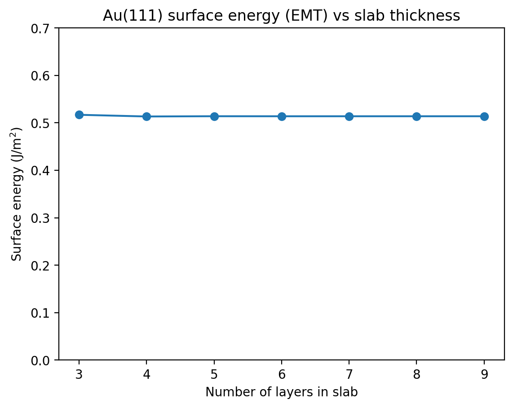
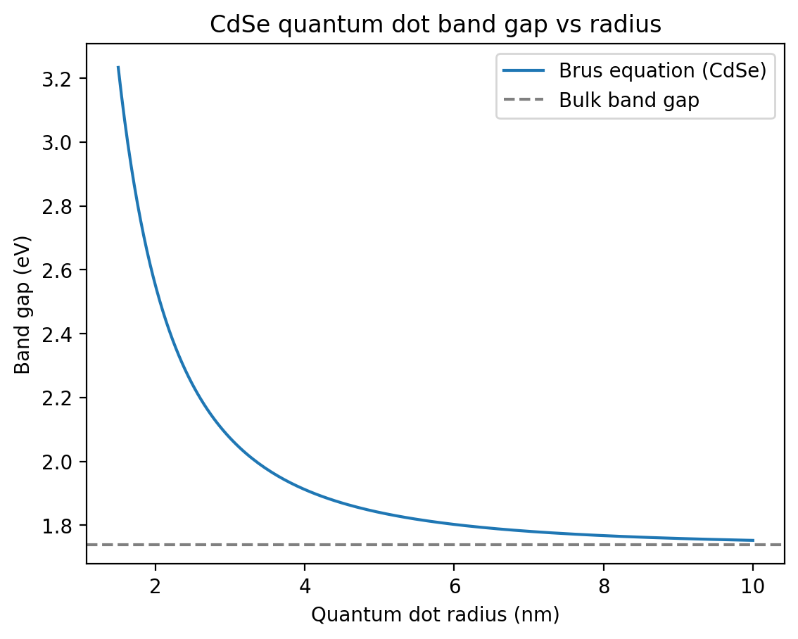

# Size Effects in Nanomaterials: From Structure to Properties and Characterization

A small computational project with three parts, built in Python (Google Colab). It shows how the structure, surface and properties of a material change when it becomes very small, and how this can be measured.

**Tools:** Python, NumPy, Matplotlib, pymatgen, ASE (EMT calculator)

## Overview

| Part | Question | Material | Notebook |
|---|---|---|---|
| 1 | How is the size of nanocrystals measured? | Gold (Au) | `Part1_XRD_size.ipynb` |
| 2 | How much extra energy does a surface carry? | Gold (Au) | `Part2_surface_energy.ipynb` |
| 3 | How does size change a property? | Cadmium selenide (CdSe) | `Part3_quantum_dot.ipynb` |

The story is: **structure → surface → property.**

---

## Part 1: XRD peak broadening vs crystallite size

**Idea.** In X-ray diffraction (XRD), peak positions identify the crystal structure, while peak width depends on crystallite size. Smaller crystals give broader peaks.

**Method.** I built an fcc gold crystal (lattice constant 4.078 Å) with pymatgen, calculated its XRD pattern for Cu Kα radiation, and broadened each peak using the Scherrer equation for crystallite sizes of 5, 10, 20 and 50 nm.

```
Scherrer equation:  β = K λ / (L cos θ)     (K = 0.9, λ = 0.154 nm)
```

**Result.** Peak positions stay the same for all sizes, but the peaks become much wider as the crystallite gets smaller (see the plot in the notebook).

**Limitations.**
- All peaks keep the same height. In a real pattern the peak area stays roughly constant, so wider peaks would also be lower.
- Strain and instrument broadening are ignored.
- The pattern is simulated, not measured.

---

## Part 2: Surface energy of Au(111) vs slab thickness

**Idea.** Atoms at a surface have fewer neighbours than atoms inside the crystal, so a surface costs extra energy. In nanoparticles a large fraction of atoms is at the surface, so this matters.

**Method.** I built Au(111) slabs of 3 to 9 layers with ASE and relaxed them with the EMT calculator. The surface energy is

```
γ = (E_slab − N · E_bulk) / (2A)
```

where E_slab is the slab energy, N the number of atoms, E_bulk the energy per atom in bulk, and A the surface area (two surfaces).

**Result.** The surface energy converges at about **0.514 J/m²** from 5 to 6 layers onward (3 layers: 0.517, 4 layers: 0.513 J/m²). The change with thickness is below 1%.



**Limitations.**
- EMT is a simple empirical model, not a quantum-mechanical (DFT) calculation, so the absolute value is approximate.
- Only the (111) surface, a 1×1 cell and no surface reconstruction.
- TODO: Not yet compared with a published value for Au(111); this is a planned next step.

---

## Part 3: Quantum dot band gap vs radius (CdSe)

**Idea.** In a very small semiconductor particle the electron is squeezed into a tiny space, which raises its energy. This is quantum confinement: smaller dots have a larger band gap and absorb and emit bluer light.

**Method.** I used the Brus equation (effective-mass model) with typical CdSe parameters: bulk band gap 1.74 eV, electron mass 0.13 m₀, hole mass 0.45 m₀, relative dielectric constant 10.6.

```
E(R) = E_bulk + (ħ²π² / 2R²)(1/mₑ + 1/m_h) − 1.8 e² / (4π ε₀ ε_r R)
```

**Result.**

| Radius | Band gap | Band-edge wavelength |
|---|---|---|
| 2 nm | 2.55 eV | 486 nm |
| 3 nm | 2.07 eV | 598 nm |
| 5 nm | 1.84 eV | 674 nm |
| 8 nm | 1.77 eV | 701 nm |



**Limitations.**
- The Brus equation is a simplified model and, as far as I know, overestimates the band gap for very small dots, so values at small radii should be taken as approximate.
-The parameters are commonly quoted values for CdSe and were not checked against a primary source
- The dot is assumed to be a perfect sphere with no surface effects.
- TODO: Not yet compared with a published CdSe size curve (experiments usually report diameter, which is 2 × radius).

---

## What I learned
- How XRD peak width relates to crystallite size.
- How to compute and converge a surface energy with ASE.
- How quantum confinement changes the band gap of a semiconductor with size.
- That every model has limits, and that results should be compared with published data.

## How to run
Open any notebook in Google Colab. Part 1 and Part 2 need `!pip install pymatgen ase matplotlib numpy` in the first cell.
